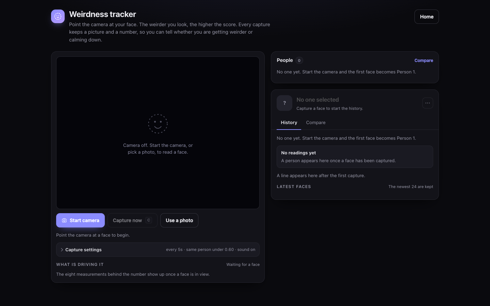

# WeirdnessTracker at the ACRYL Bootcamp

WeirdnessTracker by **Brucey (Yi Yu Bruce Liu)**: the camera watches your face, scores how weird it looks, learns whose face it is and keeps a history of every capture.

- GitHub: <https://github.com/yiyubruceliu>
- ACRYL Bootcamp, Vienna, 20 November 2026: <https://github.com/acrylworkshop/bootcamp-2026-11-20>

This repository is a mirror of <https://github.com/yiyubruceliu/WeirdnessTracker>. The screenshot was taken from the app at the bootcamp.
